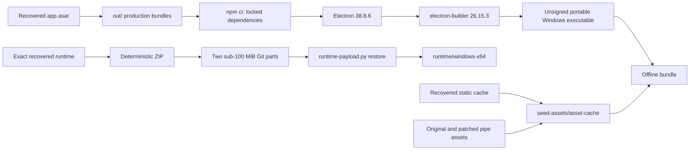
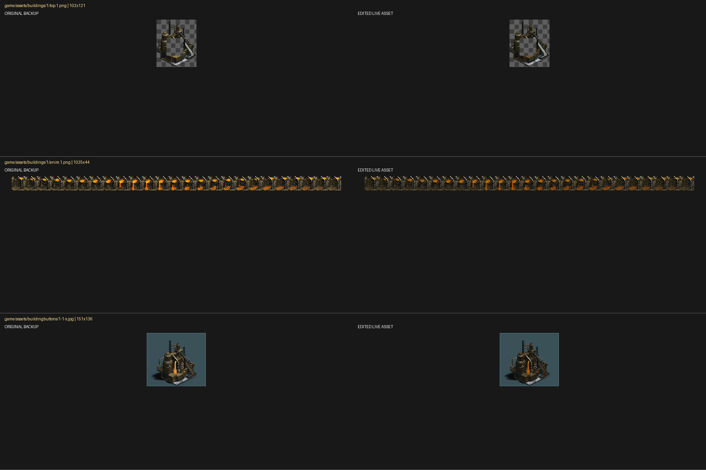

# Warcommanding — recovered and reproducible Electron game launcher

[](https://github.com/adybag14-cyber/Warcommanding/actions/workflows/build-windows.yml)
[](https://github.com/adybag14-cyber/Warcommanding/actions/workflows/integrity.yml)

This repository preserves the recovered War Commander Electron launcher, the complete asset-cache snapshot available during recovery, the darker-brown water-pipe modification, the exact packaged Windows runtime, and deterministic scripts for rebuilding and packaging the application in GitHub Actions.

> [!IMPORTANT]
> The original unbundled development source and source maps were not present. `out/main/index.bundle.mjs` and `out/preload/preload.bundle.cjs` are recovered production bundles extracted from `app.asar`. The repository can reproducibly package those bundles, but a new executable will not be byte-for-byte identical to the original release because signing certificates, timestamps and the original release environment are unavailable.

> [!CAUTION]
> The recovered binary and game assets may be subject to third-party rights and terms. Read [NOTICE.md](NOTICE.md) before redistribution. This public repository does not itself grant a licence to proprietary content.

## Preserved components

| Component | Location | Purpose |
|---|---|---|
| Reconstructed Electron application | `out/` | Bundled main process, preload, HTML, configuration and artwork |
| Exact recovered Windows runtime | `payloads/runtime-windows-x64/` | Two ordinary-Git ZIP parts that reconstruct all 30 runtime files exactly |
| Recovered asset cache | `seed-assets/asset-cache/` | 345 directly browsable cached assets, including the modified pipe |
| Water-pipe patch | `patches/water-pipe/` | Original and darker-brown variants with apply/restore tooling |
| Integrity records | `manifests/` | SHA-256, byte-size and relative-path manifests |
| Automation | `.github/workflows/` | Source build, payload restoration/integrity and offline release jobs |

No Git LFS account or bandwidth allowance is required. The compressed runtime is split into a 90 MiB part and a 33.77 MiB part, both under GitHub's 100 MiB individual-file limit.

## Architecture



At runtime the launcher obtains a Steam authentication ticket, opens the configured HTTPS game canvas, and intercepts eligible CDN requests through its `wccache://` protocol. The static cache can be seeded into `%APPDATA%\warcommander\asset-cache`.

## Requirements

- Windows 10 or Windows 11 x64
- Git 2.40 or newer
- Node.js 24.x and npm 11.x
- Python 3.11 or newer
- Steam running with access to Steam app ID `4336770` for normal authentication

## Clone

```powershell
git clone https://github.com/adybag14-cyber/Warcommanding.git
cd Warcommanding
npm ci
```

## Run the exact recovered distribution

The raw runtime is generated locally from the committed split archive:

```powershell
npm run runtime:restore
./scripts/Use-RecoveredRuntime.ps1 -SeedAssets
```

`Use-RecoveredRuntime.ps1` automatically restores the runtime when it is absent. Add `-NoGpu` for software-rendering troubleshooting.

The restored tree is ignored by Git and is verified against `manifests/runtime-windows-x64.sha256` before use.

## Build from reconstructed source

```powershell
npm ci
npm run verify:source
npm run dist:win
```

Output:

```text
dist/WarCommander-1.0.0-x64-portable.exe
```

The build is unsigned. The exact recovered binary remains separately reproducible from the split payload.

## Create a complete offline bundle

```powershell
npm run bundle:offline
```

This creates `release/WarCommander-offline-bundle.zip`, containing the newly built portable executable, all 345 cached assets and an installer for `%LOCALAPPDATA%` and `%APPDATA%`.

## Runtime payload maintenance

Verify the committed archive parts:

```powershell
npm run payload:verify
```

Restore them:

```powershell
npm run runtime:restore
```

Recreate the deterministic split archive after an authorised runtime change:

```powershell
./scripts/Create-RecoveredRuntimePayload.ps1
npm run checksums
```

The archive uses fixed ZIP timestamps and sorted paths, then splits at exactly 90 MiB. Restoration verifies both payload-part hashes and every extracted runtime file.

## Asset cache

Install the recovered cache:

```powershell
./scripts/Seed-AssetCache.ps1 -BackupExisting -Force
```

The repository contains static assets and `.cache-manifest.json` only. It excludes Chromium cookies, browser caches, local/session storage, Steam tickets, account state and personal settings.

The snapshot contains **345 files / 54,199,998 bytes**. It is the complete cache recovered on 25 July 2026, not a claim that every asset ever used by the live service is present.

## Darker-brown water-pipe modification

Building ID `1` uses:

- `game/assets/buildings/1/top.1.png`
- `game/assets/buildings/1/anim.1.png`
- `game/assets/buildingbuttons/1-1-s.jpg`

Apply the committed darker-brown variants:

```powershell
npm run patch:water-pipe
npm run checksums
```

Restore the recovered originals:

```powershell
npm run restore:water-pipe
npm run checksums
```



## Integrity verification

```powershell
npm run verify:assets
```

This verifies:

- both split runtime ZIP parts;
- all 345 cached assets;
- the complete 30-file restored runtime, when `runtime/windows-x64` exists.

Manifests:

- `manifests/runtime-payload-parts.sha256`
- `manifests/runtime-windows-x64.sha256`
- `manifests/asset-cache.sha256`

## GitHub Actions

| Workflow | Trigger | Result |
|---|---|---|
| `build-windows.yml` | Push, pull request, manual | Sparse source checkout and unsigned x64 portable build |
| `integrity.yml` | Payload/asset changes, manual | Verifies payloads and performs a full isolated runtime restoration |
| `offline-bundle.yml` | Manual or `v*` tag | Builds a portable executable plus complete asset seed; tags create Releases |

Create a tagged release:

```powershell
git tag v1.0.0
git push origin v1.0.0
```

## Repository layout

```text
.
├── .github/workflows/          # CI, integrity and release automation
├── docs/assets/                # README comparison artwork
├── manifests/                  # Payload, runtime and asset SHA-256 manifests
├── out/                        # Recovered production Electron bundles
├── patches/water-pipe/         # Reversible original/patched assets
├── payloads/runtime-windows-x64/ # Split exact-runtime ZIP payload
├── scripts/                    # Build, restore, seed, bundle and launch scripts
├── seed-assets/asset-cache/    # Directly browsable recovered static assets
├── tools/                      # Verification, patch and payload utilities
├── package.json
└── package-lock.json
```

`runtime/`, `dist/` and `release/` are generated locally and ignored.

## Reproducibility boundary

This repository reproduces the recovered application packaging and local asset state. It does not reproduce remote services, Steam ownership, server-side game logic, CDN content never downloaded, original TypeScript/source maps, signing certificates or the original timestamped release process.

## Troubleshooting

**Runtime payload verification fails**

```powershell
npm run payload:verify
git status --short
```

Restore clean payload parts from Git before retrying.

**Steam is not initialised**

Start Steam, sign in to an account authorised for app ID `4336770`, then relaunch.

**Black window or GPU-composition issue**

```powershell
npm run start:no-gpu
```

or:

```powershell
./scripts/Use-RecoveredRuntime.ps1 -NoGpu
```

**Live service replaces a modified asset**

The launcher compares local MD5 entries with the live server manifest. A server update can invalidate a local modified asset. Reapply the patch and regenerate the local cache manifest.

## Provenance

- Packaged application version observed: `38.8.6`
- Electron rebuild version: `38.8.6`
- Steamworks dependency: `steamworks.js 0.4.0`
- Packaging tool: `electron-builder 26.15.3`
- Platform: Windows x64
- Recovered runtime: 30 files / 288,780,757 bytes
- Split runtime payload: 129,780,039 bytes
- Asset snapshot: 345 files / 54,199,998 bytes
- Recovery snapshot date: 25 July 2026

See [CONTRIBUTING.md](CONTRIBUTING.md), [SECURITY.md](SECURITY.md), and [NOTICE.md](NOTICE.md).
