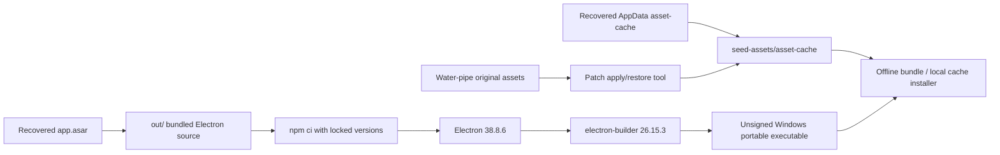

# Warcommanding — recovered and reproducible Electron game launcher

[](https://github.com/adybag14-cyber/Warcommanding/actions/workflows/build-windows.yml)
[](https://github.com/adybag14-cyber/Warcommanding/actions/workflows/integrity.yml)

This repository preserves the recovered War Commander Electron launcher, the complete asset-cache snapshot available during recovery, the darker-brown water-pipe asset modification, and deterministic scripts for rebuilding and packaging the Windows application in GitHub Actions.

> [!IMPORTANT]
> The original unbundled development source and source maps were not present. `out/main/index.bundle.mjs` and `out/preload/preload.bundle.cjs` are recovered production bundles extracted from `app.asar`. The repository can reproducibly package those recovered bundles, but a newly built executable will not be byte-for-byte identical to the signed/released binary because code signing, timestamps and the original release environment are unavailable.

> [!CAUTION]
> The recovered binary and game assets may be subject to third-party rights and terms. Read [NOTICE.md](NOTICE.md) before redistribution. This public repository does not itself grant a licence to proprietary content.

## What is preserved

| Component | Location | Purpose |
|---|---|---|
| Reconstructed Electron application | `out/` | Bundled main process, preload, HTML, configuration and launcher artwork |
| Recovered Windows distribution | `runtime/windows-x64/` | Immediately runnable original packaged runtime, stored in Git LFS |
| Recovered asset cache | `seed-assets/asset-cache/` | 345 static cached files, including the modified pipe assets, stored in Git LFS |
| Water-pipe patch | `patches/water-pipe/` | Original and darker-brown variants plus deterministic apply/restore tooling |
| Integrity records | `manifests/` | SHA-256, file-size and relative-path manifests |
| Automation | `.github/workflows/` | Source build, full integrity verification and offline-bundle release jobs |

## Architecture



At runtime the launcher obtains a Steam authentication ticket, opens the configured HTTPS game canvas, and intercepts eligible CDN asset requests through its `wccache://` protocol. Static assets can be pre-seeded into `%APPDATA%\warcommander\asset-cache` to reproduce the recovered local asset state.

## Requirements

- Windows 10 or Windows 11 x64
- Git 2.40 or newer
- Git LFS 3.x
- Node.js 24.x and npm 11.x
- Python 3.11 or newer for checksum and asset-patch utilities
- Steam running with access to Steam app ID `4336770` for normal launcher authentication

## Clone everything

```powershell
git clone https://github.com/adybag14-cyber/Warcommanding.git
cd Warcommanding
git lfs pull
npm ci
```

A normal clone without `git lfs pull` contains pointer files instead of the recovered runtime and asset payloads.

## Fastest recovered-runtime launch

```powershell
./scripts/Use-RecoveredRuntime.ps1 -SeedAssets
```

Use software rendering for troubleshooting:

```powershell
./scripts/Use-RecoveredRuntime.ps1 -SeedAssets -NoGpu
```

`-SeedAssets` backs up an existing cache and then installs the committed snapshot into `%APPDATA%\warcommander\asset-cache`.

## Build from reconstructed source

```powershell
npm ci
npm run verify:source
npm run dist:win
```

The portable executable is written to `dist/WarCommander-1.0.0-x64-portable.exe`.

The build is unsigned. Set `CSC_IDENTITY_AUTO_DISCOVERY=false` in unattended environments to prevent code-signing discovery.

## Create a complete offline bundle

```powershell
npm run bundle:offline
```

This produces `release/WarCommander-offline-bundle.zip`, containing:

- the newly built portable executable;
- the recovered 51.69 MiB asset-cache snapshot;
- an installation script that places the executable in `%LOCALAPPDATA%` and the cache in `%APPDATA%`.

## Asset cache installation only

```powershell
./scripts/Seed-AssetCache.ps1 -BackupExisting -Force
```

Custom destination:

```powershell
./scripts/Seed-AssetCache.ps1 -Destination 'D:\WarCommanderCache' -Force
```

No cookies, Chromium profile databases, Steam tickets, local/session storage or account settings are included.

## Darker-brown water-pipe modification

The modified material is building ID `1`, represented by:

- `game/assets/buildings/1/top.1.png`
- `game/assets/buildings/1/anim.1.png`
- `game/assets/buildingbuttons/1-1-s.jpg`

Apply the committed darker-brown variants to the repository cache:

```powershell
npm run patch:water-pipe
npm run checksums
```

Restore the recovered originals:

```powershell
npm run restore:water-pipe
npm run checksums
```


## Integrity verification

```powershell
npm run verify:assets
```

The verifier checks every byte against:

- `manifests/runtime-windows-x64.sha256`
- `manifests/asset-cache.sha256`

Each line records SHA-256, byte size and repository-relative path. GitHub Actions performs the same verification whenever the binary payloads or manifests change.

## GitHub Actions

| Workflow | Trigger | Output |
|---|---|---|
| `build-windows.yml` | Push, pull request, manual | Unsigned x64 portable executable |
| `integrity.yml` | Binary/manifest changes, manual | Full Git LFS payload verification |
| `offline-bundle.yml` | Manual or `v*` tag | Portable executable plus complete asset seed; tagged builds create a GitHub Release |

Create a tagged release:

```powershell
git tag v1.0.0
git push origin v1.0.0
```

## Repository layout

```text
.
├── .github/workflows/          # CI, integrity and release automation
├── docs/assets/                # README comparison artwork
├── manifests/                  # SHA-256 manifests
├── out/                        # Recovered production application bundles
├── patches/water-pipe/         # Reversible original/patched assets
├── runtime/windows-x64/        # Original recovered packaged application (LFS)
├── scripts/                    # Build, seed, bundle and launch scripts
├── seed-assets/asset-cache/    # Complete recovered static cache snapshot (LFS)
├── tools/                      # Verification and patch utilities
├── package.json
└── package-lock.json
```

## Reproducibility boundary

This repository reproduces the **application packaging and local asset state** that were recovered. It does not reproduce remote KIXEYE services, Steam ownership/authentication, server-side game logic, CDN content that was never downloaded, original TypeScript/source maps, release signing certificates, or the exact original build timestamp.

The seed directory is the complete cache snapshot recovered on 25 July 2026, not a claim that every asset ever used by the live service is present.

## Troubleshooting

**Git LFS pointer text appears instead of a binary**

```powershell
git lfs install
git lfs pull
```

**Steam is not initialised**

Start Steam, sign in to an account authorised for app ID `4336770`, then relaunch.

**Black window or GPU-composition issue**

```powershell
npm run start:no-gpu
```

or use `./scripts/Use-RecoveredRuntime.ps1 -NoGpu`.

**The cache is replaced by the server**

The launcher compares local MD5 entries with the live server manifest. A server-side asset update can legitimately invalidate a local modified asset. Reapply the patch and regenerate the local cache manifest, while understanding that live-service behaviour can change.

## Provenance

- Packaged application version observed: `38.8.6`
- Electron version used for rebuild: `38.8.6`
- Steamworks dependency: `steamworks.js 0.4.0`
- Packaging tool: `electron-builder 26.15.3`
- Platform: Windows x64
- Recovery snapshot date: 25 July 2026

See [CONTRIBUTING.md](CONTRIBUTING.md), [SECURITY.md](SECURITY.md), and [NOTICE.md](NOTICE.md).
